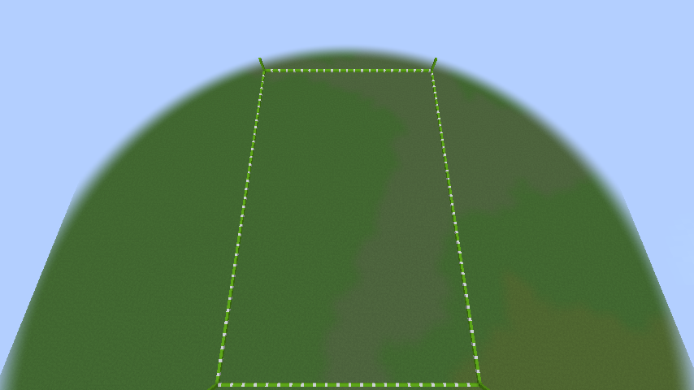
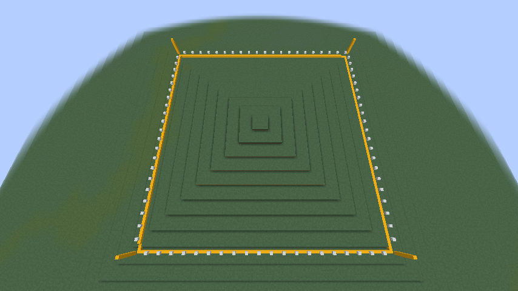
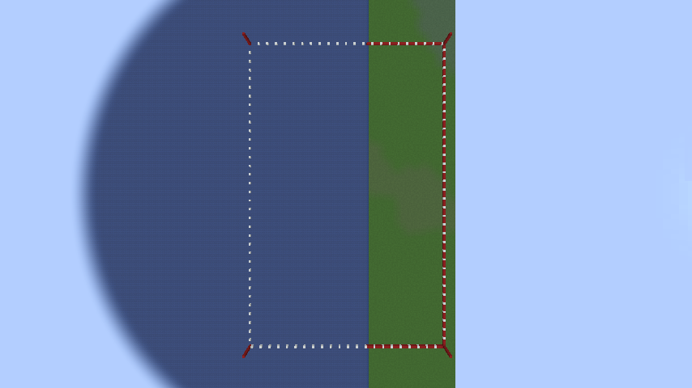
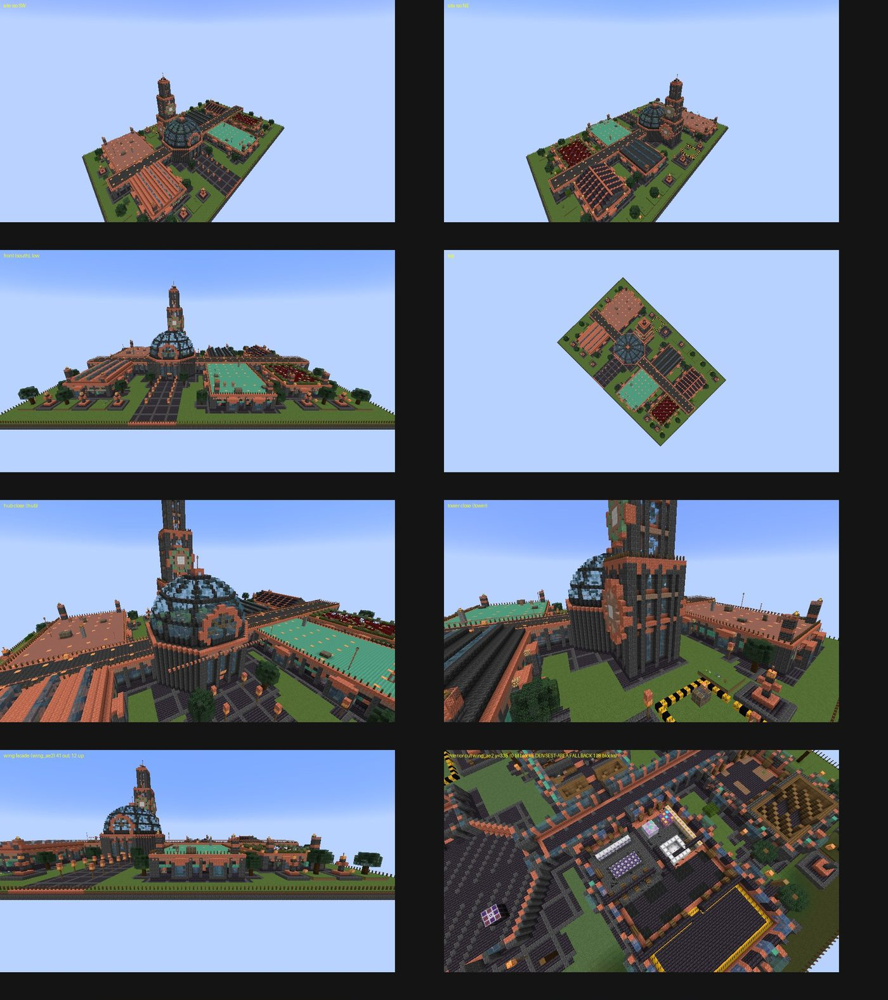

# MC MCP

A NeoForge 1.21.1 mod that runs an [MCP](https://modelcontextprotocol.io) server inside Minecraft, on
the client and on dedicated servers, so Claude (or any MCP client) can profile and debug a modpack
directly: FPS, TPS, chunks, entities, heap/GC, mixins, spark profiles, and a chat bridge to talk to
Claude from in game.

- Transport: streamable HTTP, plain JSON responses (no SSE). `POST /mcp`.
- Client: `http://127.0.0.1:47860/mcp`, localhost only. In singleplayer it also reaches the
  integrated server (tick stats, server world state, spark `server` side, teleports).
- Dedicated server: `http://127.0.0.1:47870/mcp`, bearer token always required (generated into the
  config on first start), and only loopback/LAN client addresses that match `allowlist` are accepted.
  Set `bind = "0.0.0.0"` (or the LAN IP) to reach it from another machine.
- Read-only by default. `[features] actions = true` adds the `[action]` tools; `actionsCommands`
  adds `run_command` on top.
- spark is optional. Without it the `spark_*` tools say so; nothing else changes.

## Connect Claude Code

```bash
claude mcp add --transport http minecraft http://127.0.0.1:47860/mcp
```

Server (token from `config/mcmcp-common.toml`, `[server] token`):

```bash
claude mcp add --transport http minecraft-server http://<server-ip>:47870/mcp --header "Authorization: Bearer <token>"
```

## Tools

| Tool | Side | What it returns |
|---|---|---|
| `status` | both | versions, mod count, world/player, pause/screen, enabled tool groups, tool list |
| `frame_stats` | client | FPS avg, 1% / 0.1% low, frame ms avg/p50/p95/p99/worst, frames over 50/100 ms, for the last N s (or `fresh=true`: the next N s), plus render settings |
| `measure` | client | waits `settle_s`, then frame stats + integrated-server ticks + GC pauses + heap over `seconds` |
| `client_world_state` | client | loaded chunks, rendered sections (F3 `C:`), entities / block entities / ticking block entities by type, particles, distances, GPU/CPU |
| `tick_stats` | both* | TPS, MSPT avg/p95/max (last 100 ticks), per dimension |
| `server_world_state` | both* | per dimension: loaded chunks, entities, block entities, ticking block entities by type; view/simulation distance |
| `jvm_state` | both | heap, stop-the-world GC pauses vs concurrent cycles in a window, recent GC events, CPU, threads; `details` adds pools, collectors, JVM args |
| `mixins` | both | every mixin config: applied / pending (target not loaded yet) / skipped (target missing, plugin said no, or failed). `status=skipped`, `filter=<mod>` |
| `mods` | both | installed mods + versions |
| `config_list` | both | a mod's NeoForge config values with defaults and comments |
| `spark_start` / `spark_stop` | both | starts spark (`side` client = `sparkc`, server = `spark`, `threads='*'` default); stop saves locally (no upload) and returns JSON: threads, mods by self/inclusive time, hot methods with callers, optional call tree (`tree`, `min_pct`, `max_depth`). Idle time (park/sleep/IO wait/FPS limiter wait) is excluded unless `include_idle` |
| `spark_analyze` | both | re-analyze the last (or a saved) profile with another thread filter or a tree |
| `spark_status` | both | installed? running? saved profiles |
| `chat_send` | both | `[Claude] …` lines to the local player (client) or to one player (server); never broadcast |
| `chat_read` | both | recent chat box lines (client: chat, system, command output) |
| `chat_poll` / `chat_wait` | both | player messages starting with the prefix (default `@claude`); they are intercepted and never reach server chat. `chat_wait` blocks until one arrives |
| `config_set` | both, action | change + save one NeoForge config value (fires the mod's reload event) |
| `spot_save` / `spot_list` / `teleport` | both*, action | named positions in `config/mcmcp/spots.json`; teleport across dimensions |
| `video_get` / `video_set` | client (set = action) | any `Options` value: renderDistance, simulationDistance, enableVsync, framerateLimit, graphicsMode, pauseOnLostFocus, … (`save=false`: until restart only) |
| `chat_selftest` | client, action | posts `@claude <text>` through NeoForge's chat hook to test the bridge |
| `run_command` | both*, actionsCommands | run a command at op level as the player, returns its output |
| `block_info` | both* | blockstate, block id, block entity type, optional NBT at x/y/z (server-side truth) |
| `screenshot` | client, action | save a PNG of the current frame under `<gameDir>/screenshots/`, returns its path |
| `screen` | client | open screen class/title, GUI size/scale, container geometry, widgets |
| `click` | client, action | click GUI-scaled x/y in the open screen (fires `ScreenEvent.MouseButtonPressed.Pre`) |
| `key` | client, action | send a key press to the open screen |
| `close_screen` | client, action | close the current screen without the mouse |
| `look` / `look_at` | client, action | set the client player's yaw/pitch, or aim at a world position |
| `crosshair` | client | what the crosshair is actually on (block pos/face or entity) |
| `hold_key` | client, action | hold/release a key (shift, sprint/ctrl, use, attack, jump, movement) or any KeyMapping by name, including controller-bound ones |
| `click_world` | client, action | real left/right click through `startAttack`/`useItemOn`; refreshes the pick first |
| `hotbar` | client, action | select hotbar slot 0–8 |
| `chunk_rebuild` | client, action | rebuild all chunk meshes (F3+A) |
| `ghost_set` | client | create or edit a ghost build (see-through blocks drawn only on this client, never placed): palette, boxes, blocks; replace or merge |
| `ghost_list` / `ghost_info` | client | all ghosts, or one ghost's bounds, palette counts and `block_list` `[{x,y,z,state}]` (local, full state syntax; `blocks=false` omits it, `limit` default 5000, `block_list_truncated`) |
| `ghost_import` | client | load a `.schem` (Sponge v2/v3) or vanilla `.nbt` as a ghost. `path_or_name` = path, or a bare name searched (extension optional, first match wins) in `config/shapewright/schematics`, `schematics`, `config/worldedit/schematics`, `world/generated/minecraft/structures`. `id` default file stem; `x`,`y`,`z` default player feet |
| `ghost_move` | client | move, shift or rotate a ghost (stairs, logs etc. turn with it) |
| `ghost_show` | client | show/hide and opacity per ghost; global `xray` (draw over terrain), `solid` (full colour), `hud` |
| `ghost_clear` | client | delete one ghost, a `prefix/`, or all |
| `ghost_generate` | client | start the LLM architect (async, returns a job id): `style` steampunk/hextech/gothic/station_white/solarpunk, `kit`, `layout`. **World-aware**: surveys the terrain around `target` (`look` = crosshair block, default; `here`; `x,z`; or explicit `x`,`z`), picks the best site (rotation, smaller layout when tight), adds foundations and lists trees to clear. `fit=false` = old flat build at `x`,`z` (min corner, default player); `use_area=true` builds in the `ghost_area` preview. One job at a time, cost-capped. Needs `architect/.env` + a python venv on the machine running the client (see `architect/README.md`) |
| `world_survey` | client | read-only terrain survey of the loaded client world (never loads chunks): `x`,`z` (default the looked-at block, else player feet) or `target`, `radius` (default 48), `step` (default 2), `grid=false` for summary only. Returns a compact base-36 heightmap grid + per-cell flags (land/water/lava/tree/snow/unknown) and ymin/ymax/ymed, water/tree/unknown %, slope stats, biome, dominant ground block. Format in `architect/README.md` |
| `ghost_area` | client | preview where a base would go **without the LLM (no API cost)**: surveys + scores the spot with `architect/site.py` and draws a thin outline ghost `area/preview` with corner posts: **lime** = fits, **yellow** = needs foundations/terracing, **red** = blocked/water. `action` preview (default, needs `style`) / move (`dx`,`dz`) / rotate / clear / status; `target`, `layout` |
| `ghost_generate_status` | client | job state `running`/`done`/`failed`, ghost ids, API cost so far, last log lines |
| `ghost_suggest` | client | look at an area and suggest improvements (async, returns a job id): surveys the real blocks around `target` (`look` default, `here`, `x,z`, or `x`,`z`) within `radius` (8..40, default 24), then one Claude Haiku call returns 3-6 short suggestions (chat + status) and, with `overlay=true` (default), the ghost `suggest` with proposed additions (gable roof, lanterns, corner posts: cheap survival blocks). Own cost cap `ghostGenerate.suggestCostCapUsd` (default $0.10), 5 min timeout, one job at a time. Same setup as `ghost_generate` |
| `ghost_suggest_status` | client | job state, the suggestions, overlay block count, API cost, last log lines |
| `run_client_command` | client, `devClientCommands` | dev/test: run a client command (`/ghost list`) via the client dispatcher on the game thread; `suggest=true` returns tab completions. Off by default |
| `ghost_export` | client | save ghosts as `.litematic` (Litematica), `.schem` or `.nbt` under `<gameDir>/schematics/` |
| `registry_blocks` / `block_describe` | client | blocks that exist in this pack (by mod id or substring, optional state properties), or one block in detail |

### Client commands (`/ghost`)

Client-side, ghosts exist only in this client's memory. Tab completion for ids and styles.

| Command | Does |
|---|---|
| `/ghost hide [id]` / `/ghost show [id]` | hide or show one ghost, or all (same code as `ghost_show`) |
| `/ghost list` | ghosts in chat: id, block count, origin, `[hidden]` |
| `/ghost import <name> [x y z]` | same as `ghost_import`; tab completion lists schematics found in the search folders |
| `/ghost clear [id]` | delete one ghost, a `prefix/`, or all (same code as `ghost_clear`) |
| `/ghost generate <style> [look\|here\|x z] [kit] [layout] [nofit]` | same as `ghost_generate`: no coordinates = the block you look at, `here` = your feet; surveys and fits the terrain; `nofit` = old flat build. Right after `/ghost area`, with no extra words, it builds in the previewed area. Chat: started / site fit / done / failed + API cost |
| `/ghost generate confirm` | build in the previewed area (same as `ghost_generate use_area=true`) |
| `/ghost suggest [look\|here\|x z] [r=8..40] [nooverlay]` | same as `ghost_suggest`: survey the built blocks around the looked-at spot, chat 3-6 suggestions (e.g. "roof is flat: add gables", "no light on the east wall") and draw the additions as ghost `suggest` (`/ghost clear suggest` removes it). Costs API money, capped at $0.10 |
| `/ghost area <style> [look\|here\|x z] [layout]` | preview the site as a coloured outline (lime fits / yellow needs foundations / red blocked) plus one chat line: fit score, fill/cut, obstacles, layout. No LLM call, no cost |
| `/ghost area move <dx> <dz>` / `rotate` / `clear` | nudge the previewed area (re-scored on the same survey), turn it 90 degrees, or drop it |

Area preview outlines (`/ghost area hextech`): lime = fits, yellow = needs foundations, red = blocked (water, lava, unloaded).





Config (`config/mcmcp-common.toml`, section `ghostGenerate`): `python` (empty = `architect/.venv/Scripts/python.exe`, then `python`), `architectDir` (empty = `architect` next to the game's `run` folder), `costCapUsd` (default 0.15, passed to the architect as `--max-cost`).

\* on a client these need a singleplayer world (they use the integrated server).

A typical A/B test: `spot_save` → `measure` → `config_set` or `video_set` → `teleport` back → `measure`.

## How ghosts and the architect work

Ghosts are see-through block builds drawn only on your client. They are never placed in the world and never sent to a
server. `/ghost hide|show|list|clear|generate|import` and the `ghost_*` tools manage them; `ghost_export` saves them
as `.litematic`, `.schem` or `.nbt`. `ghost_import` loads a schematic as a ghost, and other mods can use the
in-process `GhostApi`.

`ghost_generate` / `/ghost generate <style>` runs an optional LLM architect (`architect/`, Claude Haiku on **your own**
API key in `architect/.env`, about $0.03 to $0.07 per build). It uses tools `campus`, `multiblock`, `shapes`, `view`,
`bill`, `export` plus a procedural layer: site layouts spine, radial, cloister, linear and terraces; building kits
for steampunk, hextech, gothic, station_white and solarpunk; and a guard against floating parts. The architect is not in
the jar. Multiblock formation in-world is not verified.



*Steampunk campus (spine layout). Hextech, gothic, station_white and solarpunk galleries, before/after, setup and
safety notes: [docs/ARCHITECT.md](docs/ARCHITECT.md).*

## Chat bridge and waking Claude

Type `@claude why is my FPS low?` in game. The message is cancelled before it is sent, shown back to
you as `[You → Claude] …`, and queued for `chat_poll` / `chat_wait`. Claude answers with `chat_send`.

Pushing a message *into* an idle Claude session: Claude Code only supports this through its
research-preview **channels**, which need a stdio MCP server, CLI only (not documented for the
desktop app). `channel/mc_channel.py` is that bridge (stdlib Python): it long-polls `chat_wait`,
emits `notifications/claude/channel` per player message, and offers a `reply` tool.

```bash
claude mcp add minecraft-chat -- python <path-to>/mc-mcp/channel/mc_channel.py
MCP_PROTOCOL_NEGOTIATION=legacy claude --dangerously-load-development-channels server:minecraft-chat
```

Without channels, Claude can hold a conversation by calling `chat_wait` in a loop while you play.

## Config (`config/mcmcp-common.toml`)

`[client]` enabled / bind / port / token · `[server]` enabled / bind / port / token / allowlist ·
`[features]` spark / mixins / chatBridge / chatPrefix / actions / actionsCommands / devClientCommands (run_client_command, default false).
`chatBridge = false` also skips the chat capture mixin (read at startup).

## Build

```bat
build.bat build
```

Uses the JDK in `toolchain\` or `..\foxs-tweaks\toolchain\`. Jar: `build/libs/mcmcp-<version>+neoforge-1.21.1.jar`.
Dev runs: `gradlew runServer`, `gradlew runClient -PquickPlay=<world>`.

## Design notes

- No compile-time dependency on any other mod. spark is driven through its own commands
  (`profiler start/stop --save-to-file`) and its saved protobuf is decoded with spark's own classes
  by reflection.
- One mixin (`ChatComponent#addMessage` capture for `chat_read`), optional (`required: false`,
  `defaultRequire 0`), switchable by config through a mixin plugin.
- Game state is read on the game thread (`GameThread.call`, 10–20 s timeout) so tools never block
  rendering; blocking tools (`chat_wait`, `measure`, `spark_stop`) wait on the HTTP worker thread.
- No native dialogs anywhere.

### In-process API for other mods (`GhostApi`)

`dev.watdafawx.mcmcp.ghost.GhostApi` (no dependency on any other mod): `static boolean isAvailable()` (client only) and
`static void set(String id, Map<BlockPos, BlockState> blocks, BlockPos origin)`. `blocks` are relative to `origin`
(world position of local 0,0,0; null keeps the ghost's origin or uses the player's feet). Safe from any thread: the
work is queued onto the client main thread. Replaces a ghost with the same id, like `ghost_import`.
