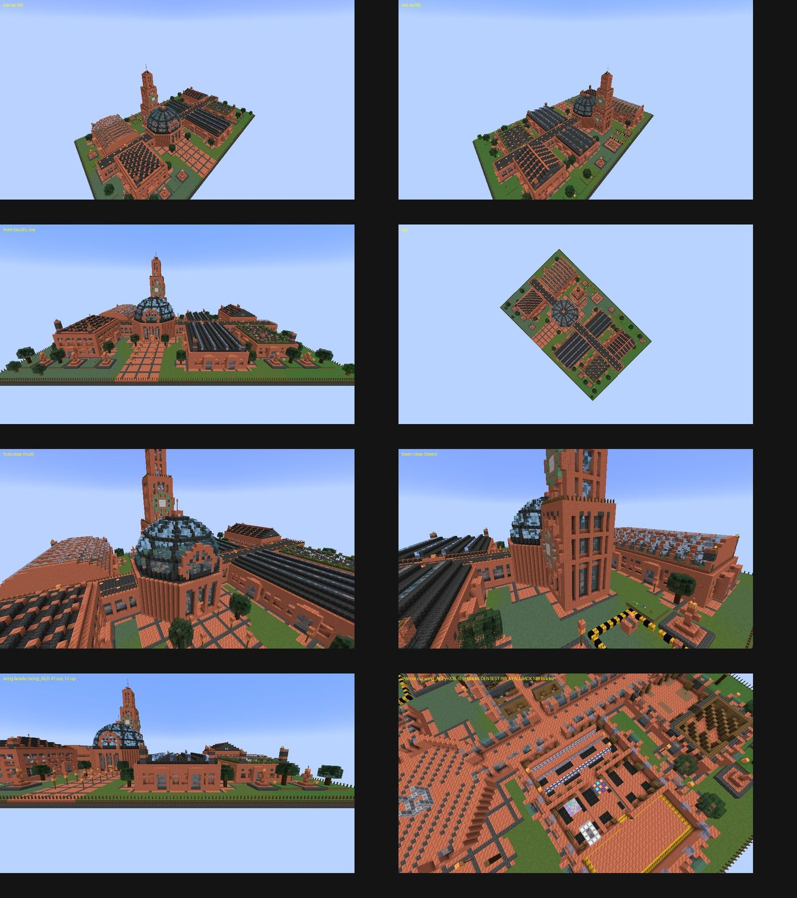
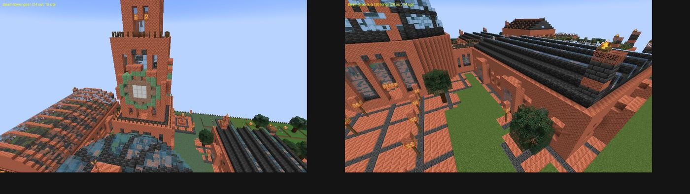
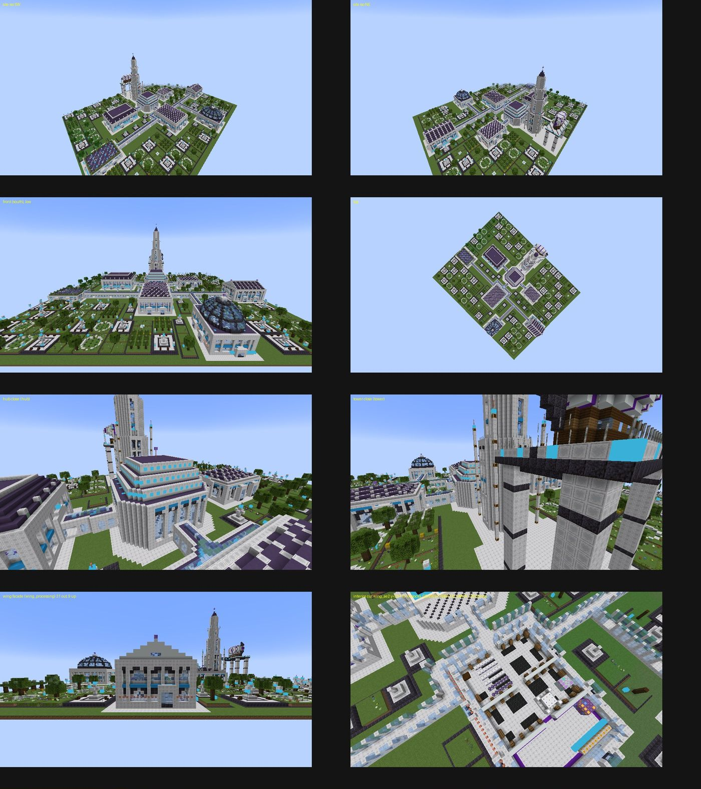
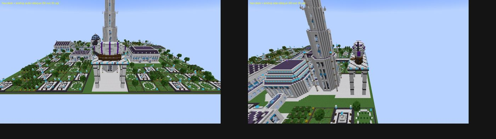
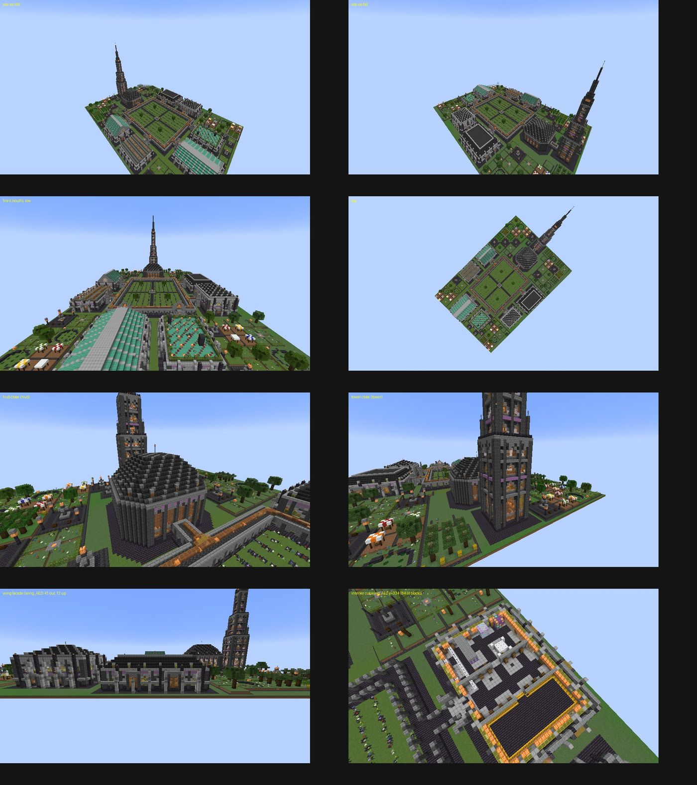
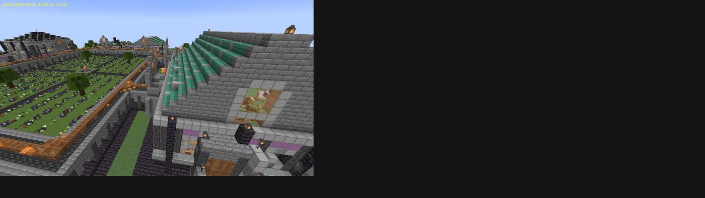
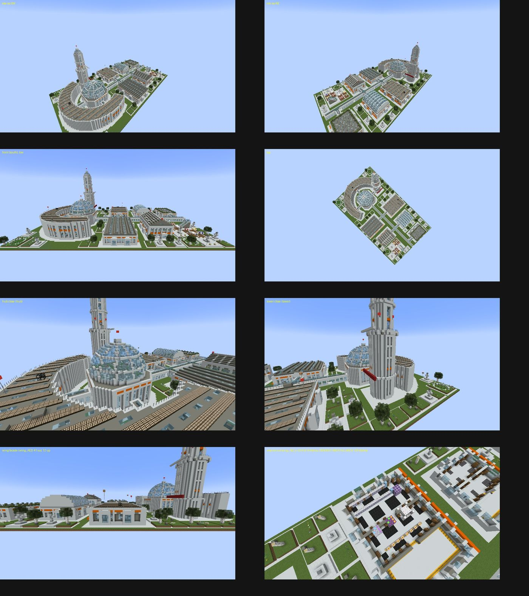
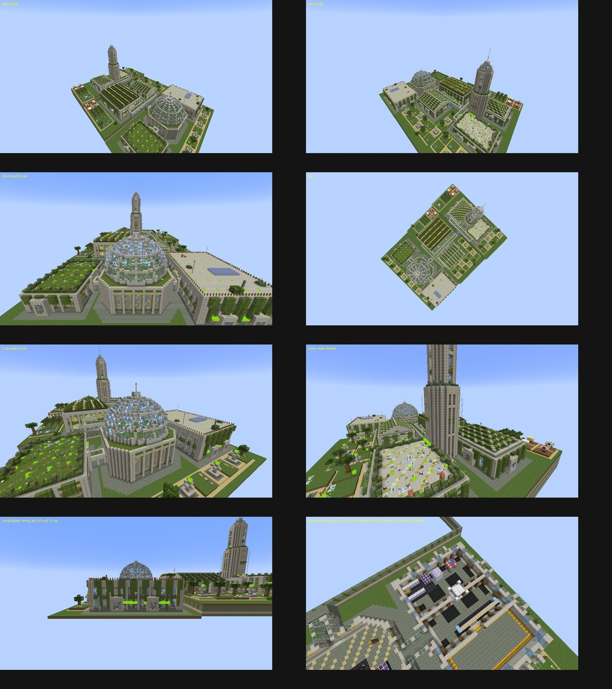
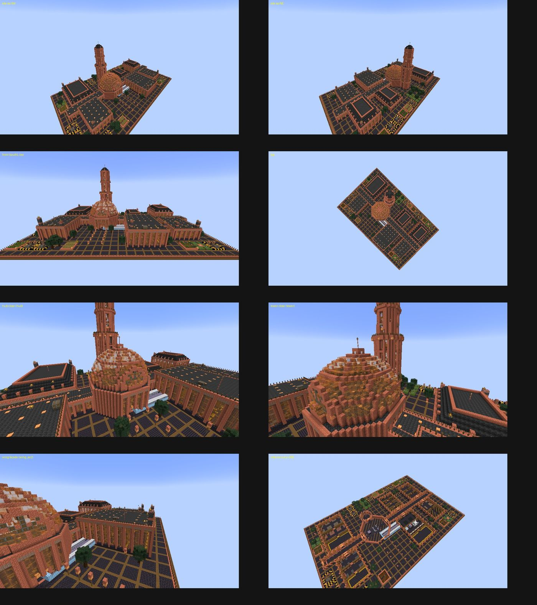

# How ghosts and the architect work

This page explains the ghost system in mc-mcp and the optional LLM "architect" that designs ghost builds for you.
It is honest about what was tested. See the end for what is **not** verified.

## What a ghost is

A ghost is a see-through block build that exists **only in your game client's memory**. It is drawn over the world
(x-ray, or solid colour) so you can look at it, walk around it and compare it with the terrain. It is never placed in
the world, never sent to a server, and never saved to the world. You can export it (`ghost_export`) as a `.litematic`,
`.schem` or `.nbt` and build it yourself, for example with Litematica.

## Tools and commands

MCP tools (served by the client, see the main README for arguments): `ghost_set`, `ghost_list`, `ghost_info`,
`ghost_move`, `ghost_show`, `ghost_clear`, `ghost_export`, `ghost_import`, `ghost_generate`, `ghost_generate_status`.

In-game commands (same code as the tools):

| Command | Does |
|---|---|
| `/ghost hide [id]`, `/ghost show [id]` | hide / show one ghost or all |
| `/ghost list` | list ghosts with block count and origin |
| `/ghost clear [id]` | delete one ghost, a `prefix/`, or all |
| `/ghost import <name> [x y z]` | load a `.schem` (Sponge v2/v3) or vanilla `.nbt` as a ghost |
| `/ghost generate <style> [x z] [kit] [layout]` | start the LLM architect (needs setup below) |

`ghost_import` looks for bare names in `config/shapewright/schematics`, `schematics`, `config/worldedit/schematics`
and `world/generated/minecraft/structures`.

## The architect pipeline (`architect/`)

`ghost_generate` / `/ghost generate` starts `architect/architect.py` as a child process on the machine that runs the
game. It talks to Claude Haiku through **your own Anthropic API key**, and drives the game through mc-mcp's own
tools (`ghost_set`, `screenshot`, ...). One job runs at a time and it stops when the estimated cost reaches
`ghostGenerate.costCapUsd` (default $0.15).

The model works with these tools:

| Tool | Purpose |
|---|---|
| `campus` | builds a whole walkable site procedurally: hub, wings, halls, tower, yards, paths |
| `multiblock` | places a mod multiblock (AE2 / ExtendedAE / AdvancedAE structures) from rules read from the mod guides |
| `shapes` | adds generated shapes (domes, rings, arches, ...) to a ghost |
| `view` | renders the ghosts and returns a screenshot so the model can look at its own work |
| `bill` | material bill of the build in raw-material cost |
| `export` | writes the schematic |

Also available to it: `knowledge` (design notes in `architect/knowledge/`), `blocks` (search the pack's blocks),
`mod_guide`, `style_refs` and `plan`.

### Procedural layer

Most of the geometry is not written block by block by the model; it is generated in Python, so a run is cheap and
the result is consistent:

- `campus.py`: site layouts `spine`, `radial`, `cloister`, `linear`, `terraces` (default per style: steampunk = spine,
  hextech = radial, gothic = cloister, station_white = linear, solarpunk = terraces). Also yards, gardens, plazas,
  towers, gears, pipes and chimneys.
- `massing.py`: building kits for five styles: **steampunk, hextech, gothic, station_white, solarpunk** (palette,
  footprints, roofs, floors, bays).
- `floaters.py`: guard that drops parts of a build that touch nothing (floating blocks).
- `multiblocks.py`, `shapes.py`, `interiors.py`, `validate.py`, `blocklib.py`: multiblock builders, shape generators,
  interiors, block-id validation and the block library.

### Judging results

During development each build was checked with a "judge sheet": a contact sheet of fixed camera views (two isometric
views, front, top, hub and tower close-ups, wing facade, interior cut). The images below are those sheets.
The sheet script is a development tool and is not part of this repo. The earlier, weaker builds (v6) are shown next
to the current ones (v14).

## Results (build v14)

Each sheet: two isometric views, front, top-down, hub and tower close-ups, wing facade, interior cut.

### Steampunk (spine layout)

*Brick-red hub with glass dome, clock tower and long factory halls with sawtooth roofs.*

### Hextech (radial layout)

*Blackstone and quartz with purple glass, radial wings around a crowned hub.*

### Gothic (cloister layout)

*Dark stone cathedral cluster around a cloister, steep roofs and a tall spire.*

### Station white (linear layout)

*White and glass research station, wings in a line along a central spine.*

### Solarpunk (terraces layout)

*Green terraced site with glass domes and planted roofs.*

### Before / after (steampunk)

v6 (before):

v14 (after): the steampunk sheet above.

## Cost

Roughly **$0.03 to $0.07 per build** with Claude Haiku in our runs (estimate from token usage; the real bill can be
slightly over). The cap is enforced by the architect (`--max-cost`, or `ghostGenerate.costCapUsd` from the mod).

## Setup

On the machine that runs the Minecraft client:

1. Create the venv: `python -m venv architect/.venv`, then
   `architect/.venv/Scripts/pip install anthropic pillow` (plus any other import in `architect.py`).
2. Create `architect/.env` containing one line: `ANTHROPIC_API_KEY=<your key>` (your own key). The file is git-ignored.
3. Optional: set `[ghostGenerate]` in `config/mcmcp-common.toml`:
   `python` (empty = `<architectDir>/.venv/Scripts/python.exe`, then `venv`, then `python`), `architectDir`
   (empty = `architect` next to the game's run folder), `costCapUsd`.
4. Some design data is generated from the pack's own mod jars and is not in the repo: run
   `python architect/blocklib.py build` to create `architect/knowledge/blocklib.json`. Paths in `architect.py`
   (`ARCHITECT_MODS`, etc.) point at the author's modpack folder; change them through the environment variables.
5. In game: `/ghost generate steampunk` (or `ghost_generate` from an MCP client).

If a file is missing the command fails at once with a message naming it.

## Shapewright and GhostApi

`GhostApi` (`isAvailable()`, `set(id, blocks, origin)`) is an in-process, thread-safe entry point so another mod, such
as Shapewright, can show its blocks as a ghost without mc-mcp depending on that mod. `ghost_import` is the file-based
counterpart: any schematic that Shapewright (or WorldEdit) saved can be loaded as a ghost.

## Safety

- Ghosts are client-side only and are never placed in the world.
- The mod never reads, logs or forwards your API key. Only the Python child process loads `architect/.env`.
- `run_client_command` is a dev tool and is **off by default** (`features.devClientCommands = false`).
- `ghost_generate` spends your money on your key: keep `costCapUsd` low.
- The jar contains none of the architect; the architect lives only in this repo's `architect/` folder.

## Not verified

- Multiblock **formation in-world** (AE2, ExtendedAE, AdvancedAE) is not verified: the layouts follow the mod
  guides, but they were only viewed as ghosts, never built and formed in a world. See `architect/knowledge/sources.md`
  for the open points.
- Quality varies per run; the screenshots show the best-judged builds (v14), not the average.
- Only tested on MC 1.21.1 NeoForge in the ATM10 pack, with the Windows venv layout.
- Reference images and block-library data used during development are not shipped (third-party content).
